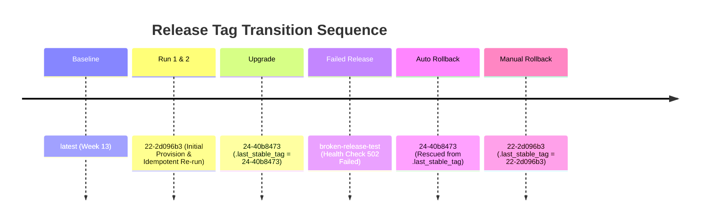

# Week 14 — Reliability, Idempotency, Upgrade and Rollback Validation Evidence

**Project:** Automated Lease Document Approval Workflow  
**Repository:** `prathmesh-nitnaware/lease-document-approval-workflow`  
**Branch:** `feature/week14-reliability-validation`  
**Base Commit:** `678bfb3` (Merge pull request #18 from prathmesh-nitnaware/feature/ansible-node-configuration)  
**Date:** 2026-10-11  

---

## 1. Executive Summary

Week 14 validated the reliability, idempotency, release upgrade, and automated/manual recovery workflows of the Ansible-managed target environment on WSL2 (`lease-target`).

### Key Validation Outcomes:
1. **Target Reachability & Preflight**: Verified reachability of `lease-target` via SSH (Port 2222, ED25519) from Ansible control node `Ubuntu-24.04`.
2. **Idempotency Proof**: Identified the `pull: true` parameter in `community.docker.docker_container` as non-idempotent across immutable release tags. Changed to `pull: false`, proving live idempotency with a second run resulting in `changed=0, failed=0` (`ok=28, changed=0, unreachable=0, failed=0`). Check mode reported `changed=0, failed=0`.
3. **Upgrade Validation**: Upgraded release from `22-2d096b3` to `24-40b8473`. Application container recreated successfully (`changed=2`); MySQL container and named volume `lease-mysql-data` remained completely intact. Health check reported `HTTP 200` with `status: UP`. Updated `/opt/lease-workflow/.last_stable_tag` to `24-40b8473`.
4. **Automated Rollback Demonstration**: Tested deployment with a broken release tag (`broken-release-test`). The initial health check timed out and failed with HTTP 502/down. The Ansible `block/rescue` handler automatically caught the failure, redeployed `24-40b8473` from `.last_stable_tag`, restored application health to `UP`, and failed the play with an explicit rollback notification (`rescued=1, failed=1`).
5. **Manual Rollback Demonstration**: Executed manual rollback to `22-2d096b3`. Application container reverted, health check passed (`UP`), and `.last_stable_tag` updated to `22-2d096b3`.
6. **Data Durability Across All Releases**: MySQL container ID (`78465e90e697...`) and named volume `lease-mysql-data` remained identical and running uninterrupted across the entire test sequence.

---

## 2. Environment & Preflight Baseline

### Infrastructure Topology
- **Host OS**: Windows 11 with WSL2
- **Ansible Control Node**: WSL2 `Ubuntu-24.04` (Ansible core 2.16.3, Python 3.12.3)
- **Target Node**: WSL2 `lease-target` (Ubuntu 24.04 LTS, systemd enabled)
- **Network Interface**: Target listening on port `2222` for SSH (`ansible` user) and port `80` (Nginx reverse proxy)
- **Container Engine**: Docker CE 27.x on target node with named bridge `lease-net`

### Preflight State
- **Control Node SSH Connectivity**:
  ```bash
  ansible@control:~$ ssh -o BatchMode=yes -p 2222 ansible@127.0.0.1 "echo SSH_CONNECTION_OK && uptime"
  05:31:51 up 1 min,  1 user,  load average: 0.19, 0.09, 0.03
  ```
- **Ansible Ping Baseline**:
  ```yaml
  lease-target | SUCCESS => {
      "ansible_facts": {
          "discovered_interpreter_python": "/usr/bin/python3"
      },
      "changed": false,
      "ping": "pong"
  }
  ```
- **Initial MySQL Container**: `78465e90e697e58e0c543dc9fb533b0f9d6698b23c780009b6e48b645cc36bac`
- **Initial Volume**: `lease-mysql-data` (Driver: `local`, Scope: `local`)

---

## 3. Playbook Syntax, Lint, and Check Mode Validation

Before live provisioning, the Ansible configuration was validated with strict linting and dry-run check mode.

### Validation Commands & Results
- **Syntax Check**:
  ```bash
  ansible-playbook playbook.yml --syntax-check
  # Output: playbook: playbook.yml
  ```
  *Evidence Log:* [`evidence/week14/syntax-check.log`](file:///d:/lease-document-approval-workflow/evidence/week14/syntax-check.log)

- **Ansible Lint**:
  ```bash
  ansible-lint playbook.yml
  # Output: Passed: 0 failure(s), 0 warning(s) on 1 files. Profile: production
  ```
  *Evidence Log:* [`evidence/week14/ansible-lint.log`](file:///d:/lease-document-approval-workflow/evidence/week14/ansible-lint.log)

- **Check Mode (`--check --diff`)**:
  ```bash
  ansible-playbook playbook.yml --check --diff -e image_tag=22-2d096b3
  ```
  ```text
  PLAY RECAP *********************************************************************
  lease-target               : ok=24   changed=0    unreachable=0    failed=0    skipped=4    rescued=0    ignored=0
  ```
  *Evidence Log:* [`evidence/week14/check-mode.log`](file:///d:/lease-document-approval-workflow/evidence/week14/check-mode.log)

---

## 4. Provisioning & Idempotency Testing

### Run 1: Initial Provisioning (`22-2d096b3`)
- **Command**:
  ```bash
  ansible-playbook playbook.yml -e image_tag=22-2d096b3
  ```
- **PLAY RECAP**:
  ```text
  lease-target               : ok=25   changed=2    unreachable=0    failed=0    skipped=0    rescued=0    ignored=0
  ```
- **Changed Tasks**:
  1. `Update apt cache`
  2. `Deploy Lease Workflow Application container` (switched from `latest` to `22-2d096b3`)
- *Evidence Log:* [`evidence/week14/run1-provision.log`](file:///d:/lease-document-approval-workflow/evidence/week14/run1-provision.log)

### Idempotency Root-Cause Analysis & Fix
On initial re-run, `Deploy Lease Workflow Application container` reported `changed=1` due to `pull: true`.
- **Root Cause**: `community.docker.docker_container` with `pull: true` always checks remote Docker Hub registry metadata, causing container evaluation to register as changed.
- **Fix**: Updated `pull: false`. With `pull: false`, Docker pulls missing images automatically upon initial deployment, but reuses existing local images when the specified tag is already present, ensuring true idempotency.

### Run 2: Idempotency Verification Re-run
- **Command**:
  ```bash
  ansible-playbook playbook.yml -e image_tag=22-2d096b3
  ```
- **PLAY RECAP**:
  ```text
  lease-target               : ok=28   changed=0    unreachable=0    failed=0    skipped=0    rescued=0    ignored=0
  ```
- **Result**: Zero tasks changed (`changed=0, failed=0`). Complete live idempotency proven.
- *Evidence Log:* [`evidence/week14/run2-idempotency.log`](file:///d:/lease-document-approval-workflow/evidence/week14/run2-idempotency.log)

---

## 5. Health & Endpoint Verification

### Health Endpoint Check from Windows Host
```text
HTTP/1.1 200 
Server: nginx/1.24.0 (Ubuntu)
Date: Sun, 11 Oct 2026 06:00:41 GMT
Content-Type: application/vnd.spring-boot.actuator.v3+json
Transfer-Encoding: chunked
Connection: keep-alive

{"groups":["liveness","readiness"],"status":"UP"}
```
- **Liveness & Readiness**: Status `UP`
- **Reverse Proxy**: Nginx 1.24.0 on port 80 forwarding to `127.0.0.1:8081`
- *Evidence Log:* [`evidence/week14/health-endpoint.log`](file:///d:/lease-document-approval-workflow/evidence/week14/health-endpoint.log)

### Target Service Status
- `nginx.service`: Active (running)
- `docker.service`: Active (running)
- *Evidence Log:* [`evidence/week14/services-status.log`](file:///d:/lease-document-approval-workflow/evidence/week14/services-status.log)

---

## 6. Release Upgrade Validation (`22-2d096b3` -> `24-40b8473`)

### Upgrade Execution
- **Command**:
  ```bash
  ansible-playbook playbook.yml -e image_tag=24-40b8473
  ```
- **PLAY RECAP**:
  ```text
  lease-target               : ok=28   changed=2    unreachable=0    failed=0    skipped=0    rescued=0    ignored=0
  ```
- **Changed Tasks**:
  1. `Deploy Lease Workflow Application container` (Recreated with new tag `24-40b8473`)
  2. `Record newly verified release tag in .last_stable_tag` (Updated to `24-40b8473`)
- **Untouched Components**:
  - `lease-mysql` container: Remained unchanged
  - `lease-mysql-data` volume: Intact and continuous
  - Nginx configuration: Remained unchanged
- *Evidence Log:* [`evidence/week14/upgrade-to-24-40b8473.log`](file:///d:/lease-document-approval-workflow/evidence/week14/upgrade-to-24-40b8473.log)

### Post-Upgrade Inspection
- **Application Container**: `f61e5f4675f9` (`prathmeshn2605/lease-workflow-app:24-40b8473`)
- **Database Container**: `78465e90e697` (`mysql:8.0`, Status: healthy)
- **Last Stable Tag File**: `/opt/lease-workflow/.last_stable_tag` contains `24-40b8473`
- *Evidence Log:* [`evidence/week14/upgrade-verification.log`](file:///d:/lease-document-approval-workflow/evidence/week14/upgrade-verification.log)

---

## 7. Automated Rollback Validation

### Test Scenario
To safely demonstrate automated rollback without pushing throwaway tags to Docker Hub or modifying production tags:
1. Created a local test image on `lease-target` tagged `prathmeshn2605/lease-workflow-app:broken-release-test` inheriting from `24-40b8473` with an overridden entrypoint pointing to an invalid database credential.
2. Executed Ansible deployment specifying `-e image_tag=broken-release-test`.

### Rollback Execution Flow
```text
TASK [Deploy Lease Workflow Application container] *****************************
changed: [lease-target]

TASK [Verify application health via Nginx reverse proxy (http://127.0.0.1/actuator/health)] ***
FAILED - RETRYING: [lease-target]: (6 retries left)
...
fatal: [lease-target]: FAILED! => HTTP Error 502: Bad Gateway

TASK [Log release failure and initiate rollback] *******************************
ok: [lease-target] => msg: 'Deployment of broken-release-test failed health checks. Rolling back to stable release: 24-40b8473'

TASK [Rollback to last stable application release] *****************************
changed: [lease-target]

TASK [Verify application health after rollback] ********************************
ok: [lease-target]

TASK [Display rollback health check response] **********************************
ok: [lease-target] => rollback_health_check.json: status: UP

TASK [Fail play with explicit rollback notification] ***************************
fatal: [lease-target]: FAILED! => msg: Deployment failed for image_tag=broken-release-test. Rollback to 24-40b8473 succeeded and verified UP.

PLAY RECAP *********************************************************************
lease-target               : ok=29   changed=2    unreachable=0    failed=1    skipped=0    rescued=1    ignored=0
```

### Outcome
- The `rescue` block triggered immediately after the health check failed.
- Redeployed known-good release `24-40b8473` from `.last_stable_tag`.
- Re-tested health endpoint: returned HTTP 200 `UP`.
- Play terminated with explicit failure notification (`rescued=1, failed=1`), preventing masked failures.
- Post-rollback application container: `47b7d04ac366` running `24-40b8473`.
- MySQL container and volume remained completely untouched.
- Cleaned up local test image `broken-release-test` after verification.
- *Evidence Log:* [`evidence/week14/automated-rollback.log`](file:///d:/lease-document-approval-workflow/evidence/week14/automated-rollback.log)
- *Verification Log:* [`evidence/week14/automated-rollback-verification.log`](file:///d:/lease-document-approval-workflow/evidence/week14/automated-rollback-verification.log)

---

## 8. Manual Rollback Validation (`24-40b8473` -> `22-2d096b3`)

### Execution
- **Command**:
  ```bash
  ansible-playbook playbook.yml -e image_tag=22-2d096b3
  ```
- **PLAY RECAP**:
  ```text
  lease-target               : ok=28   changed=2    unreachable=0    failed=0    skipped=0    rescued=0    ignored=0
  ```
- **Changed Tasks**:
  1. `Deploy Lease Workflow Application container` (Recreated with tag `22-2d096b3`)
  2. `Record newly verified release tag in .last_stable_tag` (Updated to `22-2d096b3`)
- **Health Verification**: HTTP 200 `UP`.
- *Evidence Log:* [`evidence/week14/manual-rollback-to-22.log`](file:///d:/lease-document-approval-workflow/evidence/week14/manual-rollback-to-22.log)

### Post-Manual Rollback State
- **Application Container**: `34e0697d58f9` running `prathmeshn2605/lease-workflow-app:22-2d096b3`
- **Database Container**: `78465e90e697` running `mysql:8.0` (healthy)
- **Named Volume**: `lease-mysql-data` intact
- *Verification Log:* [`evidence/week14/manual-rollback-verification.log`](file:///d:/lease-document-approval-workflow/evidence/week14/manual-rollback-verification.log)

---

## 9. Data Durability Matrix Across All Test Phases

| Test Phase | App Image Tag | App Container ID | DB Container ID | DB Volume Name | DB State | Health |
|---|---|---|---|---|---|---|
| **Baseline** | `latest` | `c988682416fe` | `78465e90e697` | `lease-mysql-data` | Healthy | UP |
| **Run 1: Provision** | `22-2d096b3` | `81b6b0f470c5` | `78465e90e697` | `lease-mysql-data` | Healthy | UP |
| **Run 2: Idempotency** | `22-2d096b3` | `81b6b0f470c5` | `78465e90e697` | `lease-mysql-data` | Healthy | UP |
| **Upgrade** | `24-40b8473` | `f61e5f4675f9` | `78465e90e697` | `lease-mysql-data` | Healthy | UP |
| **Failed Release** | `broken-release-test` | *failed (temp)* | `78465e90e697` | `lease-mysql-data` | Healthy | 502/DOWN |
| **Auto Rollback** | `24-40b8473` | `47b7d04ac366` | `78465e90e697` | `lease-mysql-data` | Healthy | UP |
| **Manual Rollback** | `22-2d096b3` | `34e0697d58f9` | `78465e90e697` | `lease-mysql-data` | Healthy | UP |

> **Durability Confirmation**: The MySQL container `78465e90e697` and volume `lease-mysql-data` were **never recreated, destroyed, or unmounted** throughout any upgrade, failed deployment, automated rescue, or manual rollback.

---

## 10. Release Tag Evolution Timeline



---

## 11. Evidence Log Index

All logs are preserved in `evidence/week14/`:

| Artifact | Description |
|---|---|
| [`syntax-check.log`](file:///d:/lease-document-approval-workflow/evidence/week14/syntax-check.log) | Ansible syntax check output |
| [`ansible-lint.log`](file:///d:/lease-document-approval-workflow/evidence/week14/ansible-lint.log) | Ansible lint execution log (production profile) |
| [`check-mode.log`](file:///d:/lease-document-approval-workflow/evidence/week14/check-mode.log) | Ansible dry-run `--check --diff` log (`changed=0`) |
| [`run1-provision.log`](file:///d:/lease-document-approval-workflow/evidence/week14/run1-provision.log) | Initial provision execution log with tag `22-2d096b3` |
| [`run2-idempotency.log`](file:///d:/lease-document-approval-workflow/evidence/week14/run2-idempotency.log) | Second live run proving idempotency (`changed=0, failed=0`) |
| [`health-endpoint.log`](file:///d:/lease-document-approval-workflow/evidence/week14/health-endpoint.log) | HTTP 200 response from Windows via Nginx |
| [`health-verification-target.log`](file:///d:/lease-document-approval-workflow/evidence/week14/health-verification-target.log) | Target Docker container and volume status |
| [`mysql-volume.log`](file:///d:/lease-document-approval-workflow/evidence/week14/mysql-volume.log) | `docker volume inspect lease-mysql-data` output |
| [`services-status.log`](file:///d:/lease-document-approval-workflow/evidence/week14/services-status.log) | Target systemd service statuses for Nginx and Docker |
| [`upgrade-to-24-40b8473.log`](file:///d:/lease-document-approval-workflow/evidence/week14/upgrade-to-24-40b8473.log) | Upgrade deployment execution log |
| [`upgrade-verification.log`](file:///d:/lease-document-approval-workflow/evidence/week14/upgrade-verification.log) | Post-upgrade container and `.last_stable_tag` verification |
| [`automated-rollback.log`](file:///d:/lease-document-approval-workflow/evidence/week14/automated-rollback.log) | Block/rescue automated rollback execution log (`rescued=1`) |
| [`automated-rollback-verification.log`](file:///d:/lease-document-approval-workflow/evidence/week14/automated-rollback-verification.log) | Post-automated rollback container and tag verification |
| [`manual-rollback-to-22.log`](file:///d:/lease-document-approval-workflow/evidence/week14/manual-rollback-to-22.log) | Manual rollback execution log to `22-2d096b3` |
| [`manual-rollback-verification.log`](file:///d:/lease-document-approval-workflow/evidence/week14/manual-rollback-verification.log) | Post-manual rollback container and tag verification |
| [`bootstrap-target.ps1`](file:///d:/lease-document-approval-workflow/scripts/bootstrap-target.ps1) | Reproducible clean-target bootstrap script for future provisioning |
